# 云枢-众擎安全管家 安装指南

终端安全管控软件旨在防范病毒、勒索软件及数据泄露，并满足《网络安全法》等合规要求。为确保公司信息资产安全，所有办公设备必须安装本软件，原则上禁止使用个人设备办公，详见 4.2。

## 1 安装

下载前请确认当前连接网络为公司内网：WiFi（ENGINEAI）/ 有线网络

### 下载地址

Windows：http://10.0.6.100:5000/sharing/l6zDYfeYW

Ubuntu(amd64)：http://10.0.6.100:5000/sharing/7l1PR07KQ（优先使用 apt install 安装）

Mac：http://10.0.6.100:5000/sharing/B5Lp1T5Qe

备用链接（可互联网下载）：https://brizoo.eagleyun.com/download#XUDxVLFgPzMZ

### 员工隐私政策

[《员工个人信息处理授权同意书》](https://dx3a2bminsq.feishu.cn/wiki/FhzHwZ0yViYRbZkNZLxcK8xZnXb?from=from_copylink)

## 2 登录

### 1. 关闭代理

如有使用个人代理软件，请在安装登录过程中关闭，以免配置混乱影响后续联网。

### 2. 企业标识符

由于各机型适配问题，个别情况下需要手动输入企业标识符。

如弹出以下窗口，请在输入框中输入：engineai

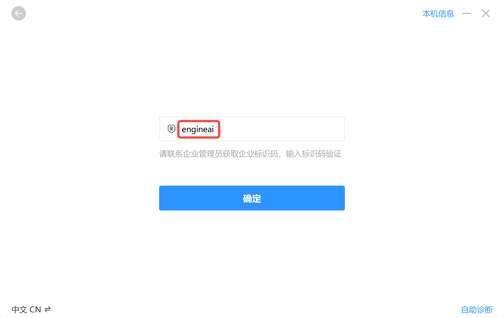

### 3. 登录方式选择

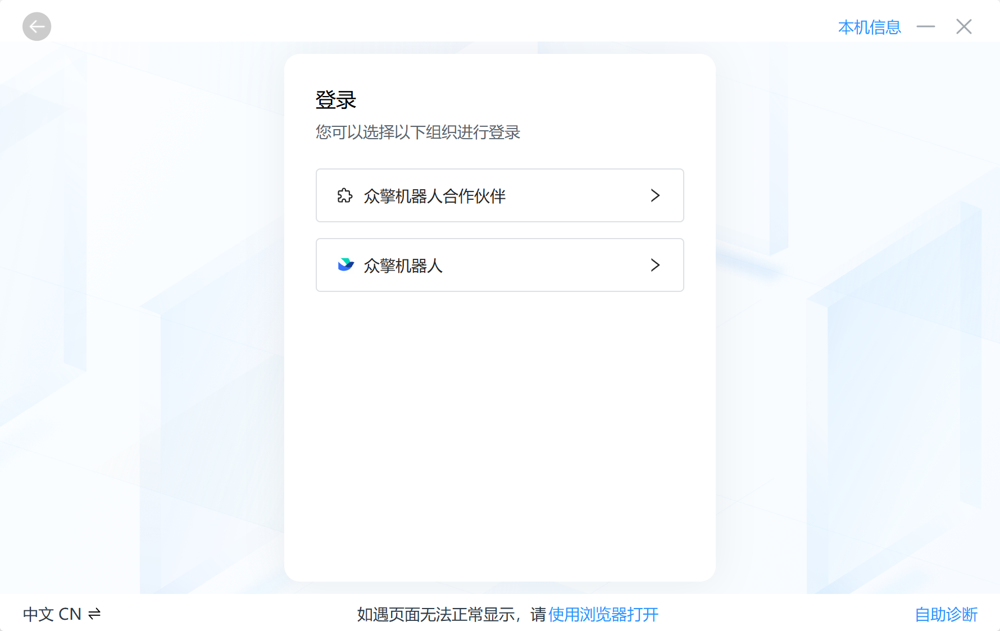

请根据当前飞书组织关系选择你的登录方式，与实际人员类型无关。

飞书账号在 众擎机器人 下的请直接通过飞书扫码登录；飞书账号在 合作伙伴组织 下的请通过账号密码登录。具体如下表所示：

| 飞书组织关系 | 确认方式 | 选择登录组织 | 登录方式 |
| --- | --- | --- | --- |
| 深圳众擎机器人科技股份有限公司 | 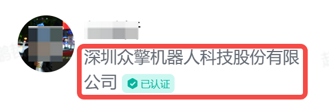 | 众擎机器人 | 飞书扫码登录 |
| 众擎机器人合作伙伴 |  | 众擎机器人合作伙伴 | 账号密码登录 |

### 4. 合作伙伴账号密码

合作伙伴账号密码由人工手动创建，由合作伙伴直属上级进行调配。

合作伙伴账号清单由各管理同学与IT部协同维护，如有问题，请联系你的直属上级或IT部信息安全同事。

### 5. Mac端授权操作

请确保Mac电脑分配必要的权限

权限设置指南：【系统设置】-【隐私与安全性】打开完全磁盘访问权限、录屏与系统录音

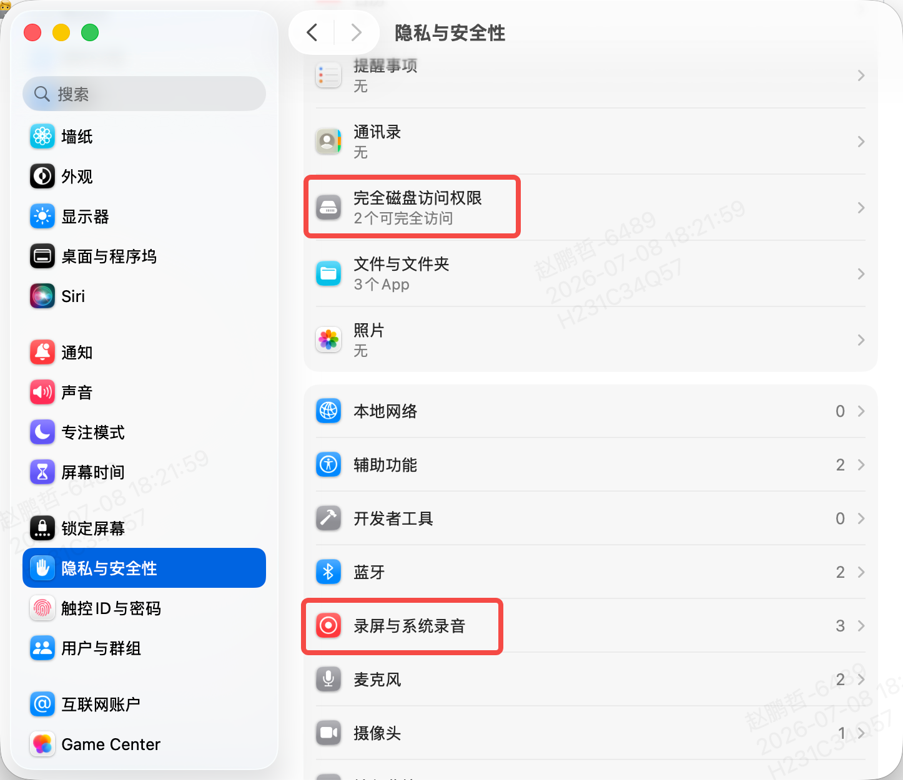

系统将定期检查合规策略，并在安全-合规提示或飞书-众擎安全管家进行提示。

可点击右上角提示，参照指示进行授权。

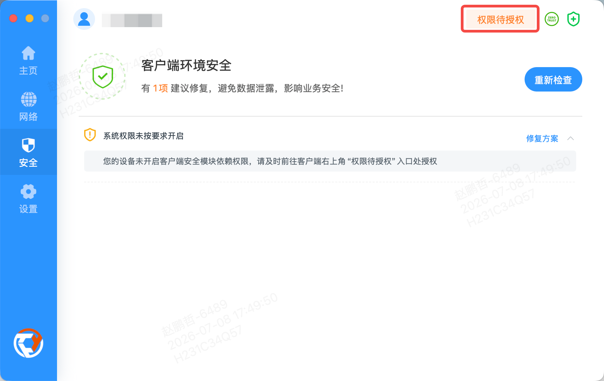

PS：Mac用户安装软件时本机账号密码无法登录，请联系IT部桌面运维同事升级权限。

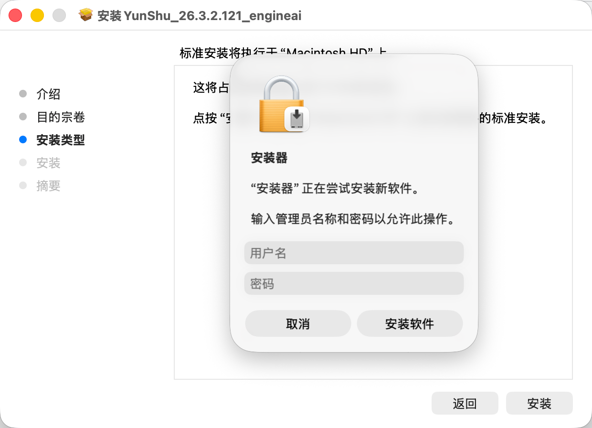

## 3 使用说明

### 功能概述

终端安全防护：实时监测并阻断病毒、勒索软件等恶意威胁。

数据防泄漏：对敏感文件的拷贝、外发、截屏等行为进行智能监控与拦截。

零信任办公：通过申请后，可在办公区内外安全连接企业内网，访问核心应用。

### 界面说明 - 网络

点击连接后，可在办公场所以外的网络环境远程访问公司内网系统（需通过审批授权）。

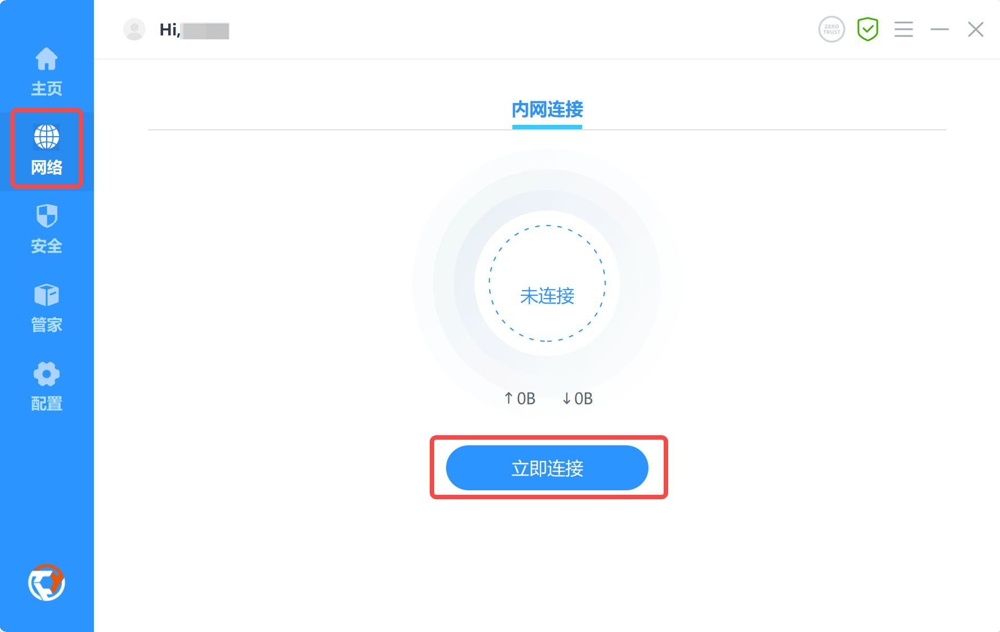

### 界面说明 - 安全

合规检测用于检查当前终端是否安装违规软件、是否违规开启移动热点、是否安装补丁、是否使用弱口令等问题

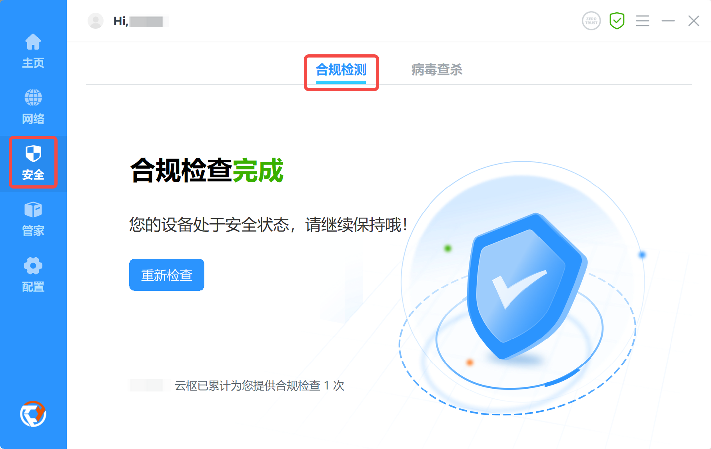

病毒查杀（仅Windows电脑）用于检查当前终端安全情况，磁盘是否包含病毒、电脑是否存在安全漏洞、是否存在被入侵利用风险。支持员工主动进行安全检查。

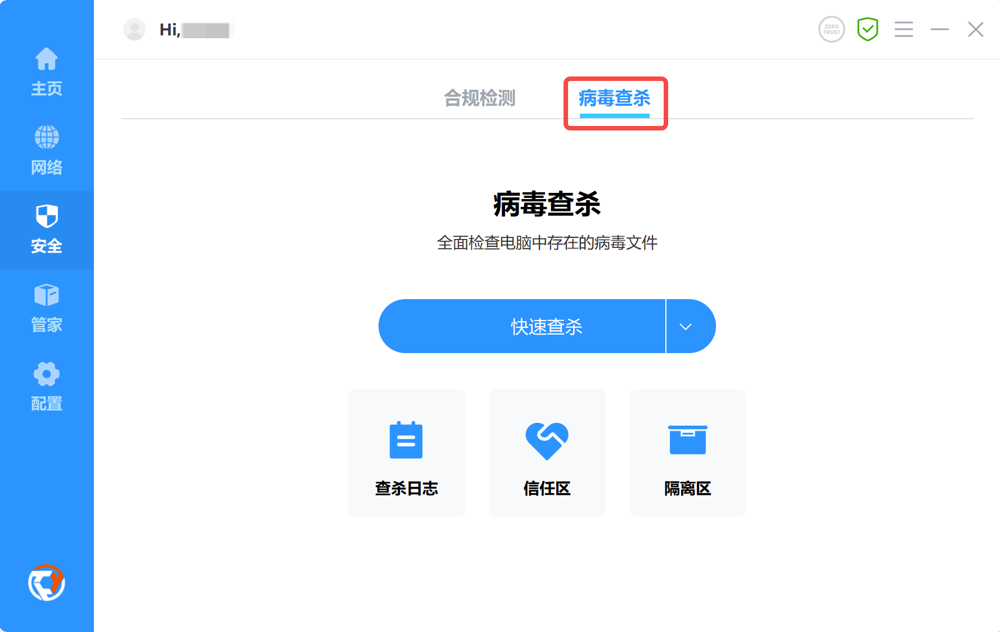

### 界面说明 - 诊断修复

主页诊断修复服务用于排查客户端故障及使用反馈。

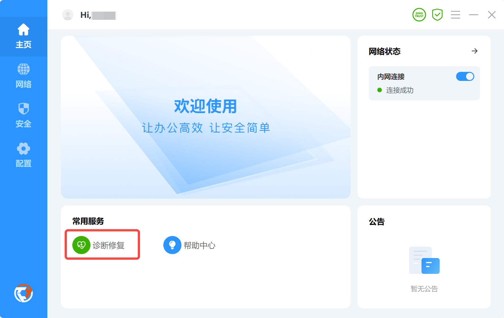

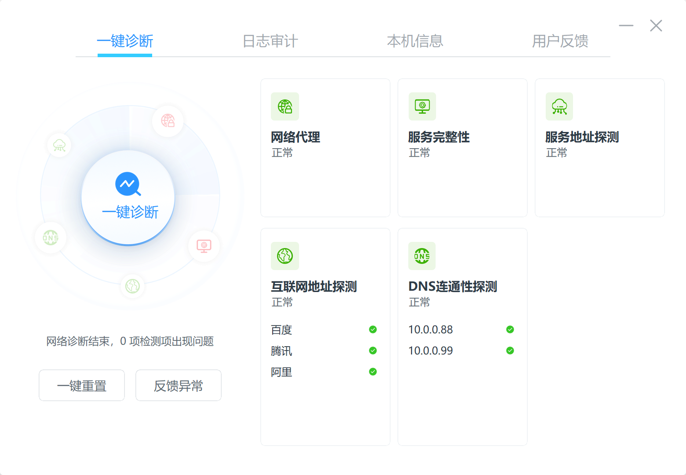

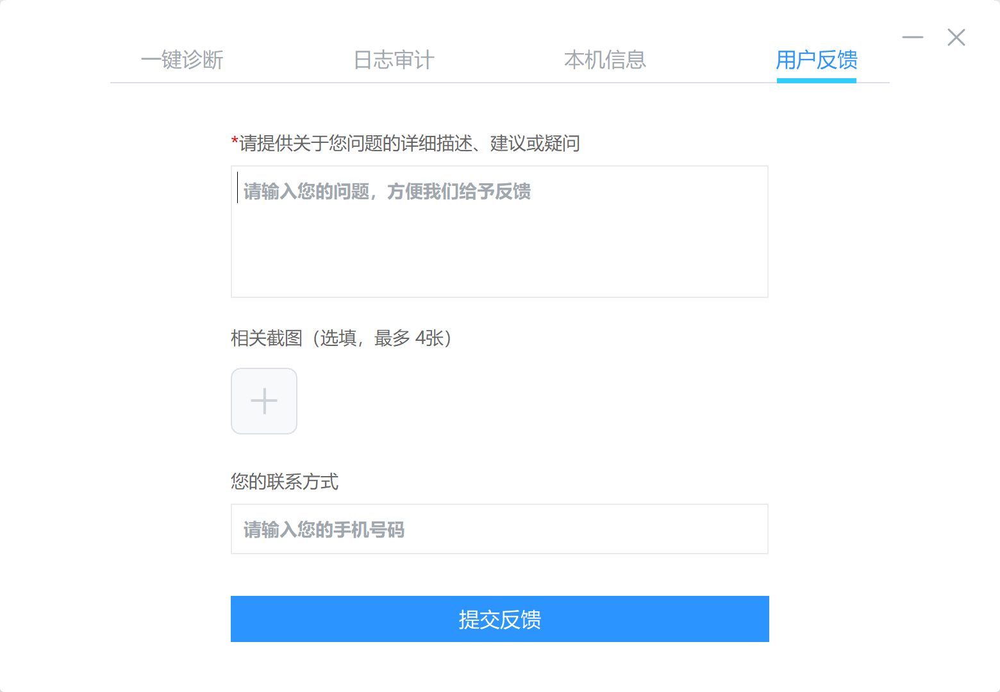

## 4 其他说明

使用过程中如有其他问题，请及时联系IT部信息安全同事

员工禁止使用个人设备进行办公，如存在特殊原因需申报HR及IT部门签署[员工个人设备办公协议.docx](https://dx3a2bminsq.feishu.cn/wiki/DWl6wktBIizEyTkzkWlc0lbUngb?from=from_copylink)，安装本软件以实施统一的安全管控（管控策略与企业配发设备标准一致）。注：安装本软件后，个人设备将视同企业设备进行管理，离职或使用结束后需统一由IT部门进行全盘格式化处理。

常见问题指南：[《云枢安装常见问题指南》](https://dx3a2bminsq.feishu.cn/wiki/W6RZw6la2ii1QgkVu0Bcoqtgnab)、[《云枢-电脑卡顿问题解决指南》](https://dx3a2bminsq.feishu.cn/wiki/PxDIwNh8SiHs9pkL7Blcd9Gsn6e)

飞书登录设备申报使用说明：[飞书无权限访问-设备申报说明](https://dx3a2bminsq.feishu.cn/wiki/X5HFwqU73irGs8k0PwycId5xncg)

## 附录：.NET 10 Codespaces 配置示例

如需使用 .NET 10 开发环境，可将以下内容保存为 `.devcontainer/devcontainer.json`。此示例独立于上述软件安装指南。

创建容器后会安装 Aspire 项目模板；仅在仓库中存在 `SampleApp` 目录时执行依赖恢复。8080 和 8081 端口的转发配置不会自动创建或启动应用。

```json
{
    "name": ".NET in Codespaces",
    "image": "mcr.microsoft.com/dotnet/sdk:10.0",
    "features": {
        "ghcr.io/devcontainers/features/docker-in-docker:2": {},
        "ghcr.io/devcontainers/features/github-cli:1": {
            "version": "2"
        },
        "ghcr.io/devcontainers/features/powershell:1": {
            "version": "latest"
        },
        "ghcr.io/azure/azure-dev/azd:0": {
            "version": "latest"
        },
        "ghcr.io/devcontainers/features/common-utils:2": {},
        "ghcr.io/devcontainers/features/dotnet:2": {
            "version": "none",
            "dotnetRuntimeVersions": "10.0",
            "aspNetCoreRuntimeVersions": "10.0"
        }
    },
    "customizations": {
        "vscode": {
            "extensions": [
                "ms-vscode.vscode-node-azure-pack",
                "GitHub.copilot",
                "GitHub.vscode-github-actions",
                "ms-dotnettools.csdevkit"
            ]
        }
    },
    "forwardPorts": [
        8080,
        8081
    ],
    "postCreateCommand": "dotnet new install Aspire.ProjectTemplates && if [ -d ./SampleApp ]; then (cd ./SampleApp && dotnet restore); else echo 'SampleApp directory not found; skipping dotnet restore.'; fi",
    "hostRequirements": {
        "memory": "8gb",
        "cpus": 4
    },
    "remoteEnv": {
        "DOTNET_MULTILEVEL_LOOKUP": "0",
        "TARGET": "net10.0"
    },
    "portsAttributes": {
        "8080": {
            "label": "Weather API",
            "onAutoForward": "notify"
        },
        "8081": {
            "label": "Weather Front End",
            "onAutoForward": "notify"
        }
    }
}
```
